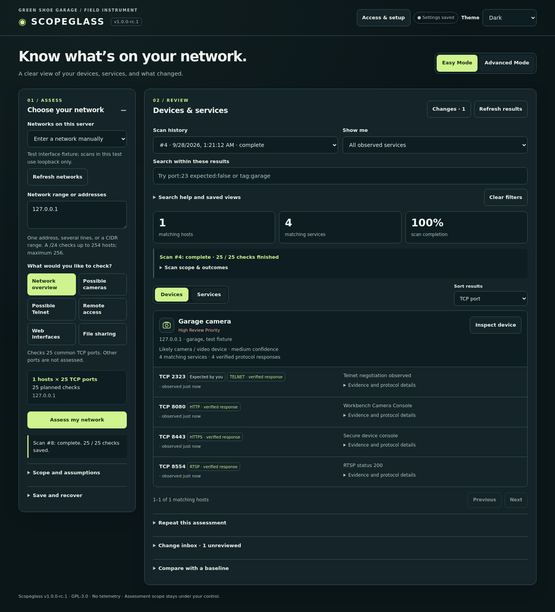
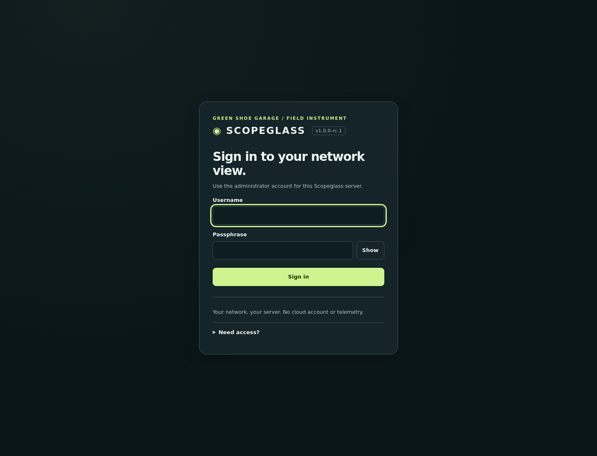

# Scopeglass v1.0.0-rc.1

A self-hosted network assessment instrument from Green Shoe Garage. Choose a network, check common services, and inspect the evidence. No subscription, telemetry, cloud API, or build step. GNU GPL v3.



*Screenshot uses loopback test fixtures. No sample observations are included in the application.*

## Quick start

Requires Python 3.10 or later. No pip dependencies.

1. Extract the ZIP into its own folder.
2. Review `config.json` (from a Git checkout, first copy `config.example.json` to `config.json`). The starter permits loopback and private IPv4 ranges; choose only networks you administer or have permission to assess.
3. From that folder run `python3 server.py --config config.json` (Windows: `py server.py --config config.json`).
4. Open **http://127.0.0.1:8765/**.
5. Select a local network or enter an address, choose an assessment, inspect the scope preview, and click **Assess my network**.

The first scan never starts automatically. `allowed_cidrs` sets which targets may be requested; it does not choose or scan every allowed network. `0.0.0.0/0` permits any IPv4 target while retaining the 256-host limit per scan. IPv6 scanning is not supported.

## Start with a question

| I want to… | Where to go |
| --- | --- |
| Find possible cameras or Telnet services | Choose an Easy assessment, preview its scope, then **Assess my network** |
| See only relevant recorded results | Use **Show me**, search, and sort; these never start a scan |
| Understand an observation | Open a device; inspect evidence, confidence, and suggested next steps |
| Remember the owner or an intentional service | Add a name, tags, notes, and expected-service flags in the device inspector |
| Track changes over time | Complete a scan, then open **Repeat this assessment** and the **Changes** inbox |
| Keep a backup or make a report | Open **Save and recover** for JSON, CSV, restore, cleanup, and **Report / PDF** |
| Add a login or install on a server | Follow the [deployment guide](deploy/README.md) |

## Current release: v1.0.0-rc.1

This release candidate brings the existing assessment, monitoring, recovery, and account workflows together for final host validation. It fixes startup collisions: another server cannot take over the same database, an occupied port leaves saved state untouched, and graceful shutdown waits for active checks to be saved. Newer database schemas are refused before modification. SQLite schema 9 and existing v0.9 data stay compatible; exports from this candidate can be restored by this candidate.

The source includes repeatable packaging, file checksums, contribution/security guidance, GitHub checks, and an isolated Docker smoke test. **Stable v1.0 is still pending actual Docker/Caddy/systemd host validation and CI/platform results.** See [RELEASE.md](RELEASE.md) for the specific gates and [TEST-REPORT.md](TEST-REPORT.md) for what was actually tested. Earlier changes are in [CHANGELOG.md](CHANGELOG.md).

## What is included

- **Scoped discovery:** local network suggestions, Easy presets or Advanced TCP ports, scope preview, durable progress, cancellation, and restart recovery.
- **Evidence you can inspect:** device/service views, protocol responses, bounded HTTP/HTTPS/RTSP metadata, severity and confidence, and practical next steps. Camera identity remains an inference.
- **Repeatable review:** names/tags/notes, expected services, focused rescans, baselines, structured search, sorting, and saved views.
- **Local monitoring:** scheduled assessments, before/after evidence, and a persistent change inbox with review state.
- **Recovery and output:** JSON export/validated restore, checked SQLite backups before maintenance, history cleanup, Fresh Start, CSV, and printable/PDF reports. Draft and stale-client protection preserve editing context.
- **Self-hosted access:** optional local administrator login, required authentication for shared listeners, terminal setup/password reset, HTTPS proxy support, and Docker/systemd examples.
- **Usable on your devices:** responsive dark, light, and high-contrast themes, keyboard controls, accessible status messages, and browser settings saved locally.



No cloud account or internet connection is needed after installation. The Python server must remain running; this is not a standalone offline browser page.

## Easy and Advanced modes

Easy Mode offers Network overview, Possible cameras, Possible Telnet, Remote access, Web interfaces, and File sharing. The preset controls the ports in a new scan. The separate **Show me** control filters already collected observations; filtering never starts a scan. Network overview includes all ports used by the focused presets plus a few common infrastructure ports.

Advanced Mode accepts comma-separated TCP ports and ranges, for example `22,80,443,8000-8003`. Maximum 256 hosts and 128 distinct ports per scan; one active scan per server and at most 16 concurrent connections. Each connection has a 650 ms connect timeout and a 1.2 second bounded response-read budget and, for TLS ports, a 1.2 second handshake timeout. Stop latency also includes database writes.

Search filters IP, port, service hint, response excerpt, captured protocol metadata, and device names/tags/notes. Scan history lists the latest 100 scans; older data remains in the database and full export. The UI retains target, ports, mode, preset, and theme locally with a visible save indicator. Scan results live on the server.

## What results establish

- An open TCP port means a connection succeeded from this scanner's network position. It does **not** establish public internet exposure.
- Labels marked **port hint** are conventional names from the operating system service table. Labels marked **verified response** indicate a recognizable protocol exchange, not authenticated device identity.
- Telnet negotiation bytes can verify the protocol. An open port 23/2323 with no recognizable exchange remains a low-confidence candidate. A different verified protocol suppresses that Telnet guess.
- Camera labels use advertised HTTP/RTSP metadata. Generic RTSP means a streaming service; it is not proof of a camera. Generic web ports alone do not identify cameras. Unusual ports, TLS settings, authentication, non-UTF-8 pages, virtual hosts, and response limits can prevent identification.
- Severity is a review priority, not a confirmed vulnerability score. Confidence describes identification evidence.
- Refused, timeout, and unreachable outcomes describe a particular attempt. A missing response can reflect a firewall, network position, temporary loss, or an inactive device.
- The scanner reads the root page on common HTTP/HTTPS ports, sends RTSP OPTIONS on common streaming ports, and reads protocol greetings elsewhere. No credentials are sent, redirects followed, video retrieved, or exploits attempted. TLS inspection accepts untrusted certificates to read public metadata; this is not a trust or expiration assessment.

## Search and saved views

Search applies to the selected scan and its current category filter. Whitespace combines terms with AND. Use double quotes for a phrase and an ASCII hyphen before a term to exclude it. There is no OR/grouping syntax in this release. Limits: 500 characters and 32 terms.

| Example | Meaning |
| --- | --- |
| `port:23 expected:false` | Port 23 observations not marked expected |
| `port:8000-8090` | TCP ports in that inclusive range |
| `protocol:telnet` | A verified Telnet response |
| `service:telnet` | Verified Telnet or an unverified service hint named telnet |
| `type:camera` | Likely camera metadata; generic RTSP alone does not qualify |
| `type:streaming` | RTSP identified without specific camera metadata |
| `type:unknown` | No device type assigned |
| `tag:garage -expected:true` | Exact tag match, excluding expected services |
| `name:"Garage camera"` | Case-insensitive device-name substring |
| `net:192.168.1.0/24` | Hosts within that range; `ip:` also accepts IPv4/CIDR |
| `verified:true severity:high` | Verified responses with a high-severity finding |
| `age:>7d` | Observations older than seven days |
| `age:<=24h` | Observations at most 24 hours old |
| `text:"http://"` | Literal text containing a colon |

Age supports `<`, `<=`, `>`, `>=` and minutes (`m`), hours (`h`), days (`d`). Unknown dates do not match a positive age comparison. Age filters use the server clock; on-screen relative labels use the browser clock. These values describe recorded observations, not whether a device is online now. `severity:` supports info/low/medium/high/critical where findings actually use those levels. `expected:` and `verified:` accept true/false. Tag matching is exact and case-insensitive; plain words search response and annotation text.

Open **Search help and saved views** to save a view. Choosing **Latest scan** before saving makes it follow the latest scan; choosing a numbered scan pins it to that record. Changing the view name creates a copy. Keeping the name and clicking **Update saved view** updates the selected record. Deleting a view asks for confirmation and does not remove observations. Saved views are shared by clients using the same server database. When login is enabled, access requires the administrator account; per-user views and permissions are not implemented.

## Scheduled assessments and change inbox

1. Run an assessment and select its completed scan in **Scan history**.
2. Open **Repeat this assessment**, enter a name and interval, and click **Create enabled schedule**. The scope is the entire selected scan, even if the results are filtered.
3. Keep Scopeglass running. You can close the browser. The first automatic run is one interval after creation; **Run now** starts a repeat immediately.
4. Use **Changes** beside Refresh results to open the inbox. Expand recorded evidence, open either source scan, investigate, then mark the change reviewed. Reviewed does not mean resolved or safe.

Schedules support 15–10,080 whole minutes (60 = hourly; 1,440 = daily; 10,080 = weekly), with at most 50 schedules. They repeat elapsed intervals, not calendar times or cron expressions. Times are stored in UTC and displayed in the browser’s local timezone. A daily interval is 24 hours, so local clock times can shift across daylight-saving transitions. The server clock controls due times; this is not a real-time monitor.

Only one scan runs at a time, including manual and scheduled scans. The scheduler checks about every two seconds. Due schedules wait for the scanner and are selected by earliest due time. The next due time is one interval after the actual launch, so long scans can delay later runs. Downtime produces at most one overdue assessment per enabled schedule, not a replay of every missed interval. Restart retains saved timing and marks in-flight scans interrupted; it does not resume their partial work.

**Pause** stops future automatic launches; **Resume** schedules the next one a full interval from now. Changing the interval also resets the due time. **Run now** works while paused and leaves the schedule paused. For enabled schedules it moves the next automatic run one interval forward. Pausing or deleting a schedule does not cancel an already claimed/running assessment; use **Stop scan** for that. Deletion retains earlier scans and inbox evidence. Edits use revision checks; on a conflict, pending fields remain visible and **Refresh schedules** loads the saved settings. Schedule form edits are saved explicitly because creating or resuming a schedule enables future network connections.

Each run rechecks the current `allowed_cidrs` configuration and existing host/port limits. If the stored scope is no longer allowed, Scopeglass pauses that schedule with an explanation, without starting a scan. Update the config and restart if appropriate, then explicitly resume. To change a schedule’s targets or ports, assess the new scope and create a new schedule; existing schedules keep their original scope.

The first completed repeat compares with its completed source scan. Subsequent completed repeats compare with the last completed scan from that schedule. Cancelled, failed, and interrupted runs do not become reference scans or generate missing-service changes. A subsequent successful run can therefore compare across a longer gap. Scan completion and inbox changes commit together. No change entries is meaningful only when the last run reports **compared: 0 changes**; a paused, incomplete, or never-run schedule has not established that result.

Inbox comparison rules:

- **Newly observed:** an IP/port appears in the current scan but not the reference scan.
- **No longer observed:** an IP/port from the reference scan has no open-service observation in the current scan. The actual current check outcome is retained; timeouts and filtering do not establish that the service was disabled.
- **Verified protocol changed:** both scans have recognizable protocol evidence and their protocol labels differ. Loss of identification alone does not prove a protocol change.
- **Certificate fingerprint changed:** both scans have TLS certificate SHA-256 fingerprints and they differ. Renewal or replacement may be expected; trust and expiry assessment remain outside this release.

Banner/title changes alone are not inbox events because they can vary on every request. IP grouping does not establish physical identity across DHCP, NAT, or reassignment. Expected-service flags do not suppress events. The inbox uses 30 entries per page and has no automatic deletion. Reviewed records remain available and can be reopened. JSON export includes schedules (including deleted records), evidence, and review state. No email, push notifications, or external notification services are used.

## Using the inspector

1. Click **Inspect device** (or an IP address in Services view).
2. Enter a name, comma-separated tags, and notes. Changes autosave to the server after a short pause.
3. Mark intended services **expected**. Their evidence and severity remain visible.
4. Review the suggested next step, make any changes directly on your device, and choose **Rescan this device** or a single-port rescan.
5. Read the focused comparison. A service that is no longer observed may be filtered or temporarily unreachable; confirm its settings on the device.

A device rescan uses all ports in its source scan, not every possible TCP port. The source and focused scan must both complete before missing/new service comparisons are made. Scope allowlists and concurrency limits still apply. An incomplete source can be rescanned, but its partial data does not establish a complete comparison.

If autosave fails, the inspector keeps edits visible and, when browser storage is available, stores a local draft. **Download edits** preserves a copy. **Reload saved device** asks before discarding unsaved changes. Close/Escape can leave the inspector after a failed save while retaining its draft; reopen the same address to recover it. If browser storage is unavailable, recovery is limited to the current tab, and the message explains that limitation. Names are limited to 120 characters, notes to 4000 characters, and tags to 12 entries of up to 32 characters each.

## Existing installation upgrade

1. Stop the old server and back up its database. If `-wal` and `-shm` files are present, preserve the entire data directory together or use SQLite's backup API.
2. Extract v1.0.0-rc.1 into a new folder, then copy your existing `config.json` into it.
3. Point `database` at your existing database, preferably with an absolute path. A relative path is resolved from the current working directory, as in prior releases. Legacy loopback configurations remain compatible. A non-loopback listener now requires `auth.enabled=true`, a configured origin, and an administrator account; use the deployment guide before starting.
4. Run the new server. It adds any missing progress fields, the checks table, protocol metadata, device annotations, focused-scan references, saved views, schedules, and change evidence without removing existing scans or baselines. v0.8 adds a dataset identity used to reject stale-client writes after restore or Fresh Start; v0.9 adds access tables without changing assessment records. Existing enabled schedules remain enabled and can run when due.

Completed legacy scans receive an inferred completed count from their saved target/port scope; per-attempt outcome breakdowns were not recorded by old versions. Interrupted legacy scans can retain open observations without an accurate historical attempt count. Back up before upgrading; downgrading after schema migration is not tested. Run only one server process against a database.

## Data, backups, and offline use

All application assets are bundled. Assessments work with no internet access when the local server and target network remain available. A disconnected browser cannot query the server; this is not a standalone static or service-worker app.

The SQLite file stores scans, per-check outcomes, open-service observations, baselines, current device annotations, saved views, schedules, and change reviews. Device annotations are keyed by IPv4 address and apply across scan history. They are not immutable historical facts; confirm ownership again when DHCP or address reassignment changes a device. There is no annotation audit trail yet. JSON export includes all these records. The **Manage data** dialog restores supported JSON exports. Full SQLite backups remain the recovery option for larger inventories or exports that fail validation. Browser preferences and unsaved inspector drafts are separate from the database. Draft downloads preserve pending edits as JSON for reference; no automatic draft import is provided.

Enabled schedules continue adding history while the server runs; a broad scan can add up to 32,768 check records. Use manual cleanup and monitor disk use. Backup files and inbox entries have no automatic retention policy.

### Restore a JSON backup

1. Open **Save and recover → Export JSON** to download your current data.
2. Open **Manage data → Restore a JSON backup**, choose the file, and click **Validate & preview**.
3. Review the incoming counts, replacement notice, and warnings. Type **RESTORE**, then click **Restore backup**.
4. The page reloads with restored data and the path to the automatic pre-change SQLite backup. Review each restored schedule before choosing **Resume**.

Restore replaces the entire assessment dataset; it does not merge. The administrator account and sessions remain unchanged. Supported archives use `scopeglass.export.v1` from v0.3–v0.9 and v1.0.0-rc.1, with a maximum file size of 16 MiB and 250,000 records. Validation checks supported shapes, IDs, references, scope, coverage, protocol metadata, and consistency between change evidence and source observations. It checks structure and consistency, not the authenticity of collected evidence. Running scans in an archive become interrupted; no scan resumes automatically. Historical addresses can be restored outside the current allowlist, but any new assessment still requires the current allowed scope.

Configuration and browser preferences are not imported. Restore clears this browser's saved inspector drafts, so download unsaved edits first. Other open tabs require a reload; drafts from their old dataset remain separate. Browser storage restrictions can prevent automatic draft/settings cleanup; the dialog reports this and offers reload. Downloaded draft JSON is a reference copy, not an importable full backup.

### Clean up old scans or start fresh

Choose **Manage data → Clean up old scans**, enter an age of 1–3,650 days, and preview. Age is measured from scan start using the server clock. Type **DELETE OLD SCANS** to remove the listed eligible records. The latest scan, running/recent scans, baseline scans, pinned saved-view scans, schedule source/last scans (including deleted schedules), change-evidence scans, and their parent/comparison reference chains are protected. Names, notes, views, schedules, baselines, and reviewed changes remain. A long comparison chain may therefore retain substantial history. No background deletion occurs, and deleting rows does not necessarily shrink the SQLite file on disk.

**Fresh Start** removes all server scans, observations, checks, baselines, annotations, views, schedules, and changes. Preview the counts and type **FRESH START**. It also resets Scopeglass preferences and drafts in the current browser. Configuration, the administrator account, sessions, and backup files remain; preferences in other browsers are unaffected.

All maintenance operations require the scanner to be idle. A preview expires after ten minutes, after a server restart, or whenever the dataset changes. Re-preview when prompted. Maintenance holds the scanner lock and a database write transaction; scheduled assessments cannot start during replacement. Restored schedules are paused, but schedules retained by cleanup can run normally afterward.

### Automatic SQLite backups and manual recovery

Before applying maintenance, Scopeglass creates `backups/scopeglass-before-<timestamp>-<random>.sqlite3` beside the configured database using SQLite's online backup API, checks integrity, flushes the file, and closes its connections. It must succeed before any records change. The completion message gives the absolute file path on the server. These backup files are not automatically deleted and are not browser downloads.

To recover a SQLite backup, stop the server, preserve the current database and any `-wal`/`-shm` sidecars together, and copy the chosen backup to a **new database filename**. Point `database` in `config.json` at that new file and restart; reload all browser tabs. Using a new filename avoids mixing an old backup with another database's sidecars. SQLite backups preserve enabled schedules, unlike JSON restore: if necessary, pause them in the original installation before backing up. Keep the service on the intended network when restarting. SQLite backups also contain the account and session hashes; protect them as sensitive files. A restored SQLite backup can revive earlier sessions: run `--set-password` before serving it to revoke those sessions.

### CSV and printable reports

Select a scan and set **Show me**, search, and sort, then choose **Results CSV** or **Report / PDF**. Both include all matching services, beyond the currently visible page, in the selected order. Each request captures a single database snapshot. Reports include scope/completion, review counts, names/tags/notes, expected-service flags, response evidence, and suggested next steps. PDF output uses the browser print dialog. CSV is for analysis, not backup restore; use JSON or SQLite for recovery.

### API clients

Scopeglass returns an `X-Scopeglass-Epoch` header on authorized JSON responses. Custom clients must read it (for example from `GET /api/status`) and send the same value on every POST except the read-only `/api/preview` scope check and `/api/auth/login`. Restore and Fresh Start rotate it; stale clients receive HTTP 409 and must reload their data before writing. This is consistency protection, not authentication.

When login is enabled, `POST /api/auth/login` with JSON `username` and `password`, retain the returned cookie, and take the `csrf` value from the response or `GET /api/auth/status`. Send it as `X-Scopeglass-CSRF` on subsequent POSTs, including scope preview, together with the epoch header where required. `POST /api/auth/logout` revokes that session; `POST /api/auth/password` accepts `current_password` and `new_password`, revokes other sessions, and returns a new cookie/CSRF value. Do not log credential bodies or bearer cookies. `/api/auth/status`, the app shell, and the minimal `/healthz` response are public; inventory and configuration APIs require login when enabled. `GET /api/deployment` supplies the installation panel.

Data endpoints: `GET /api/data/status` (record counts), `GET /api/report` (full filtered snapshot using the observations query parameters), and `POST /api/data/preview` / `POST /api/data/apply`. Preview accepts `action` (`restore`, `cleanup`, or `fresh`), plus `archive` for restore or integer `days` for cleanup. Apply repeats those inputs, the returned `token` and `scan_ids`, and the exact `confirmation` phrase shown above. Tokens bind the operation, options, and current data. Use the UI for guided recovery.

## Self-hosting

The server binds to loopback by default and works without a login on that computer. To add a login, stop it and run `python3 server.py --config config.json --setup`. Shared access requires administrator login and an HTTPS reverse proxy; the Python backend has no TLS listener and should remain private. The app uses root-relative `/api/` routes and requires a dedicated hostname/root path. A static-only host cannot run the Python scanner or SQLite database.

See [deploy/README.md](deploy/README.md) for Docker/Compose, a Linux service, proxy configuration, startup checks, reset, upgrade, and rollback. The Docker container's network position differs from the host's; loopback inside it refers to the container. Authentication currently supports one administrator, with no MFA, SSO, or per-user permissions. Sessions expire after 12 hours and sign-in attempts are throttled; behind a local proxy, clients share its peer limit. Assessment data, passphrase hashes, and session-token hashes remain in the local database. No telemetry or external authentication service is used.

## Verification

Run the server and protocol regression suite (the HTTPS test needs the `openssl` command to generate a temporary test certificate):

```sh
python3 -m unittest discover -s tests -v
```

The 57-test suite includes authentication/CSRF/Host/Origin checks, session lifecycle, password reset, guarded setup, v0.8 upgrade preservation, restore round trips, failed-backup rollback, invalid archive rejection, preview/confirmation safeguards, stale-client protection, protected cleanup, full filtered report snapshots, and export snapshot consistency under a concurrent commit, fragmented Telnet negotiation, selected-scan baseline comparison, annotation search, actual loopback TCP observation, scope rejection, preset preview, bounded cancellation, persistence, migration and restart recovery, category filtering/pagination, mismatched-baseline rejection, and network-output parsers. See `TEST-REPORT.md` for this release's verification and limits.

## Roadmap

| Release | Goal |
| --- | --- |
| v0.3 | Easy network selection, scope clarity, cancellation, restart recovery — delivered |
| v0.4 | HTTP/HTTPS metadata, RTSP response identification, device grouping and confidence — delivered |
| v0.5 | Device inspector, next steps, names/tags/notes, expected services, focused rescans — delivered |
| v0.6 | Structured search filters, sorting, saved views, observation age — delivered |
| v0.7 | Scheduled scans and local change inbox — delivered; v0.7.1 correctness and UI audit complete |
| v0.8 | Validated JSON restore, CSV, readable reports, manual history cleanup, Fresh Start — delivered |
| v0.9 | Administrator login, guided setup, Docker/service/proxy examples, upgrade preservation — delivered; live deployment verification remains |
| v1.0.0-rc.1 | Startup/shutdown correctness, final local regression review, GitHub checks, and repeatable release package — delivered |
| v1.0 stable | Execute CI/platform and intended-host Docker/Compose, Caddy, systemd, and real-device validation; resolve any failures before promotion |

## Protocol references and limits

The implementation uses the [Python ssl APIs](https://docs.python.org/3/library/ssl.html) and the basic [RTSP OPTIONS exchange](https://www.rfc-editor.org/rfc/rfc2326.html). CPython's optional bundled certificate decoder supplies human-readable X.509 fields; other runtimes may provide only the fingerprint, TLS version, and cipher. Reading metadata never establishes certificate trust. The application still has no third-party Python runtime dependency.

HTTP and TLS probes use numeric IP targets, so name-based virtual hosts may return a default site. HTTPS probing covers ports 443/8443 and TLS greeting inspection covers 465/993/995. RTSP probing covers 554/8554. Arbitrary ports receive a passive greeting read; active protocol overrides are deferred. Only the root page is fetched, with no script execution or linked-resource fetching. UTF-8 titles and simple chunked bodies are supported; compressed or truncated pages may omit titles.

## License

GNU General Public License version 3. Full text in `LICENSE`.
